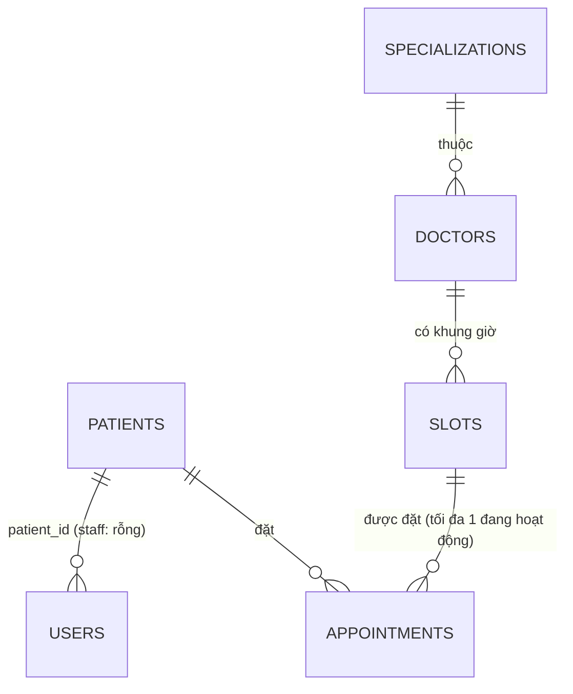
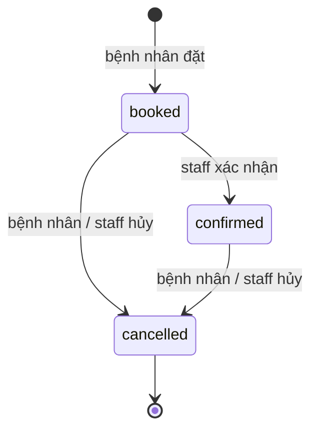

# Hiện trạng · 04 — Dữ liệu

> **Mã:** CTX-HT-04 · **Phiên bản:** v0.1 · **Ngày:** 2026-09-28
> **Trạng thái:** Bối cảnh chung cho WB-1 → WB-5 · suy ngược từ code · không phải sản phẩm nộp, không cần duyệt
> **Nguồn:** `src/db/migrate.js` (nguồn sự thật của cấu trúc), `src/db/seed.js`, `src/repositories/*`; đã đối chiếu danh sách chỉ mục trên PostgreSQL đang chạy

---

## 1. Sáu bảng

### HT-ENT-01 · `patients` — hồ sơ bệnh nhân
| Cột | Kiểu | Null | Ghi chú |
| --- | --- | :---: | --- |
| `id` | serial | ✗ | PK |
| `name` | varchar(150) | ✗ | |
| `phone` | varchar(30) | ✗ | |

Không có ngày sinh, tình trạng bệnh, mức ưu tiên hay bất kỳ dữ liệu y tế nào.

### HT-ENT-02 · `users` — tài khoản đăng nhập
| Cột | Kiểu | Null | Ghi chú |
| --- | --- | :---: | --- |
| `id` | serial | ✗ | PK |
| `name` | varchar(150) | ✗ | |
| `email` | varchar(150) | ✗ | **Duy nhất** |
| `demo_password` | varchar(80) | ✗ | Mặc định `'demo123'`. **Lưu chữ thường, không băm** (chủ ý — ADR-002) |
| `role` | varchar(20) | ✗ | CHECK `in ('patient','staff')` |
| `patient_id` | integer | ✓ | FK → `patients`. Rỗng với staff |

`alter table users add column if not exists demo_password …` (`migrate.js:20`) còn sót lại sau `create table` đã có cột này — vô hại, dấu vết của một lần thêm cột trước đây.

### HT-ENT-03 · `specializations` — chuyên khoa
`id` (PK) · `name` varchar(120), **duy nhất**.

### HT-ENT-04 · `doctors` — bác sĩ
| Cột | Kiểu | Null | Ghi chú |
| --- | --- | :---: | --- |
| `id` | serial | ✗ | PK |
| `name` | varchar(150) | ✗ | |
| `title` | varchar(150) | ✗ | Chức danh / mô tả (vd. "Chuyên khoa Tim mạch") |
| `room` | varchar(50) | ✗ | |
| `specialization_id` | integer | ✗ | FK → `specializations` |

**Không có tài khoản đăng nhập** liên kết với bác sĩ.

### HT-ENT-05 · `slots` — khung giờ khám
| Cột | Kiểu | Null | Ghi chú |
| --- | --- | :---: | --- |
| `id` | serial | ✗ | PK |
| `doctor_id` | integer | ✗ | FK → `doctors` |
| `date` | date | ✗ | **Tách riêng** khỏi giờ, hiểu theo giờ máy chủ |
| `start_time`, `end_time` | time | ✗ | Không có ràng buộc `end > start` |
| `status` | varchar(20) | ✗ | Mặc định `'available'`; CHECK `in ('available','booked')` |

Không ràng buộc duy nhất trên `(doctor_id, date, start_time)` ⇒ cùng bác sĩ có thể có nhiều slot chồng giờ (HT-GAP-05).

### HT-ENT-06 · `appointments` — lịch hẹn
| Cột | Kiểu | Null | Ghi chú |
| --- | --- | :---: | --- |
| `id` | serial | ✗ | PK |
| `patient_id` | integer | ✗ | FK → `patients` |
| `slot_id` | integer | ✗ | FK → `slots` |
| `status` | varchar(20) | ✗ | Mặc định `'booked'`; CHECK `in ('booked','confirmed','cancelled')` |
| `type` | varchar(20) | ✗ | Mặc định `'in_person'`; CHECK `in ('in_person','online')` |
| `created_at` | timestamptz | ✗ | `now()` |

**Ràng buộc sống còn** (`migrate.js:53–55`):

```sql
create unique index one_active_appointment_per_slot
  on appointments(slot_id) where status in ('booked','confirmed');
```

Mỗi slot chỉ có tối đa **một** lịch hẹn chưa hủy. Đây là lớp bảo vệ thứ hai sau khóa dòng trong service.

## 2. Quan hệ



Khóa ngoại dùng hành vi mặc định (`NO ACTION`): không xóa được bản ghi đang được tham chiếu. Không có thao tác xóa nào trong ứng dụng.

## 3. Chỉ mục có thật

Kiểm trên cơ sở dữ liệu đang chạy: khóa chính của 6 bảng · `users_email_key` · `specializations_name_key` · `one_active_appointment_per_slot`. **Không** có chỉ mục nào khác — không trên `appointments.patient_id`, `slots.doctor_id`, `slots.date`. Với 12 slot mẫu không thành vấn đề; sẽ là vấn đề khi dữ liệu lớn.

## 4. Vòng đời trạng thái

**`appointments`**



`cancelled` là trạng thái cuối. Không có đường `confirmed → booked` hay khôi phục lịch đã hủy.

**`slots`** — trạng thái được lưu riêng (không tính từ lịch hẹn):

| Chuyển | Ai gây ra | Điều kiện |
| --- | --- | --- |
| `available → booked` | Bệnh nhân đặt lịch (trong giao dịch) | Khóa dòng; slot đang trống |
| `booked → available` | Hủy lịch (trong giao dịch) | Luôn, kể cả slot đã qua ngày |
| `available → booked` | Staff chặn giờ (`PUT`) | Không kiểm tra gì thêm |
| `booked → available` | Staff mở lại (`PUT`) | Không có lịch hẹn đang hoạt động — **kiểm tra riêng, ngoài giao dịch** (HT-GAP-10) |

Slot `booked` có thể là *có lịch hẹn* hoặc *bị staff chặn* — hệ thống không phân biệt hai trường hợp này trong dữ liệu.

## 5. Bất biến cần luôn đúng

| # | Bất biến | Cơ chế | Kiểm |
| ---: | --- | --- | --- |
| I-H1 | Mỗi slot có tối đa một lịch hẹn đang hoạt động | Chỉ mục duy nhất từng phần | ✅ CSDL bảo đảm |
| I-H2 | Slot `available` không có lịch hẹn đang hoạt động | Code (giao dịch; chặn ở `updateSlot`) | ⚠️ Chỉ bằng code, có khe hở (HT-GAP-10) |
| I-H3 | Lịch hẹn đang hoạt động ⇒ slot `booked` | Code | ⚠️ Chỉ bằng code |

Truy vấn kiểm tra lệch (đã chạy trên CSDL đang chạy, cả ba trả 0):

```sql
-- I-H2
select count(*) from slots s where s.status = 'available'
  and exists (select 1 from appointments a where a.slot_id = s.id and a.status in ('booked','confirmed'));
-- I-H1
select slot_id from appointments where status in ('booked','confirmed') group by slot_id having count(*) > 1;
-- staff chặn giờ (không phải lỗi, chỉ để biết)
select count(*) from slots s where s.status = 'booked'
  and not exists (select 1 from appointments a where a.slot_id = s.id and a.status in ('booked','confirmed'));
```

## 6. Dữ liệu mẫu (`seed.js`)

| Bảng | Số dòng | Nội dung |
| --- | ---: | --- |
| `patients` | 5 | An (1), Linh (2), Huy (3), Nhi (4), Nam (5) |
| `users` | 8 | 5 bệnh nhân + Mai, Khánh, Lan (staff); mật khẩu `demo123` |
| `specializations` | 5 | Tim mạch (1), Da liễu (2), Nhi khoa (3), Tai mũi họng (4), Cơ xương khớp (5) |
| `doctors` | 6 | Hùng (1, Tim mạch), Mai (2, Da liễu), Quân (3, Nhi), **Tuấn (4, Tim mạch)**, Hà (5, TMH), Bảo (6, Cơ xương khớp) |
| `slots` | 12 | Ngày tương đối: hôm nay, +1, +2. Slot 2 và 7 ở trạng thái đã đặt |
| `appointments` | 2 | Lịch 1: An – slot 2 – `booked` – trực tiếp · Lịch 2: Linh – slot 7 – `confirmed` – online |

**Cách seed chạy** — quan trọng, vì nó chạy **mỗi lần ứng dụng khởi động** (`server.js:44–51`):
- Bản ghi seed được ghi bằng `insert … on conflict (id) do update` ⇒ **ghi đè** tên, giờ, trạng thái của bản ghi có mã trùng.
- Lịch hẹn mã 1 và 2 bị **đặt lại** về trạng thái mẫu mỗi lần khởi động, kể cả khi đã bị hủy; slot 1–12 bị đặt lại giờ và (trừ khi đang có lịch hoạt động) trạng thái.
- Hệ quả đã kiểm chứng bằng cách chạy thật: HT-GAP-01, HT-GAP-02.
- Với tùy chọn `reset`, `truncate … restart identity cascade` xóa sạch mọi bảng (`seed.js:3–14`); `npm test` luôn dùng tùy chọn này (HT-GAP-14).
- Sau khi chèn mã cứng, seed đặt lại các sequence về `max(id)` để mã tự tăng không đụng bản ghi mẫu.
